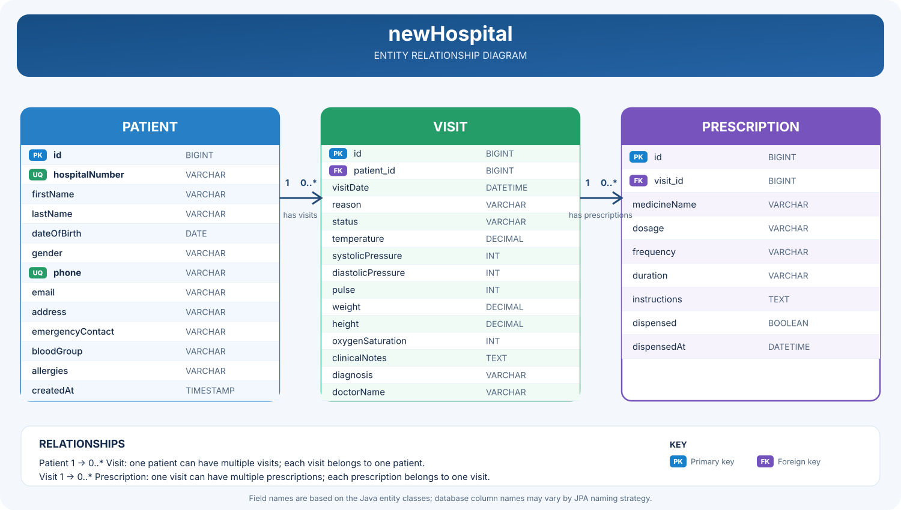

# DAN Hospital Portal

## Database Entity Relationship Diagram

The diagram below shows the relationships between patients, visits, and prescriptions.



visit the link via https://dan-hospital-demo.onrender.com/

[](https://render.com/deploy?repo=https://github.com/adejumoisris/DAN-hospital)

DAN Hospital Portal replaces paper patient cards with a simple digital workflow:

1. Reception registers or searches for a patient.
2. A nurse opens a visit and records vital signs.
3. A doctor reviews the history, records a diagnosis, and prescribes medicines.
4. Pharmacy sees the prescription and marks medicines as dispensed.

## Project structure

- `backend/` — Spring Boot REST API, Spring Data JPA, validation, and H2 database
- `frontend/` — React + Vite user interface

## Distributed Databases

### What is a distributed database?

A **distributed database** stores and/or replicates data across multiple connected database servers (nodes), potentially in different locations, while coordinating access to the data as one system.

**How it could support newHospital**
- **Availability:** replication and failover can help maintain access if a database node fails, when configured and tested properly.
- **Growth:** partitioning (sharding) can spread large workloads across nodes when one database is no longer sufficient.
- **Multiple sites:** hospital branches and application services can securely access patient, visit, and prescription data through the backend.

Distributed designs add complexity around network outages, replication delays, transaction consistency, and conflict handling. Replication is not a substitute for independent backups.

## Run the backend

Requirements: Java 8+ and Maven 3.9+.

```bash
cd backend
mvn spring-boot:run
```

## Run the frontend

Requirements: Node.js 18+.

```bash
cd frontend
npm install
npm run dev
```

Open `http://localhost:5173`. The Vite development server proxies `/api` to the backend.

## Staff login accounts

The development environment includes role-based demonstration accounts:

| Department | Username | Development password |
| --- | --- | --- |
| Administrator | `admin` | `ChangeMe123!` |
| Reception | `reception` | `Reception123!` |
| Nursing | `nurse` | `Nurse123!` |
| Doctor | `doctor` | `Doctor123!` |
| Pharmacy | `pharmacy` | `Pharmacy123!` |

Set `DAN_ADMIN_PASSWORD` before starting the backend to override the administrator password.
Set `DAN_DB_URL`, `DAN_DB_USERNAME`, and `DAN_DB_PASSWORD` to configure an external database.
The bundled department passwords are for local demonstration only and must be replaced with
database-backed user administration before production deployment.

## Production note

This is a secured working MVP with staff authentication and role permissions. Before using real
patient data, add database-backed staff administration, audit logging, encrypted backups, HTTPS,
consent/privacy policies, and replace H2 with a managed production database such as PostgreSQL.

## Deploy the demo on Render

The root `Dockerfile` builds the frontend and backend into one container. `render.yaml` defines a
free Render web service with a health check.

1. Push this repository to GitHub.
2. In Render, choose **New > Blueprint** and select the repository.
3. Enter a secure value for `DAN_ADMIN_PASSWORD` when prompted.
4. Deploy and open the generated `onrender.com` address.

The free service uses temporary H2 storage. Do not enter real patient information; demo records
can disappear after a restart or redeployment.
